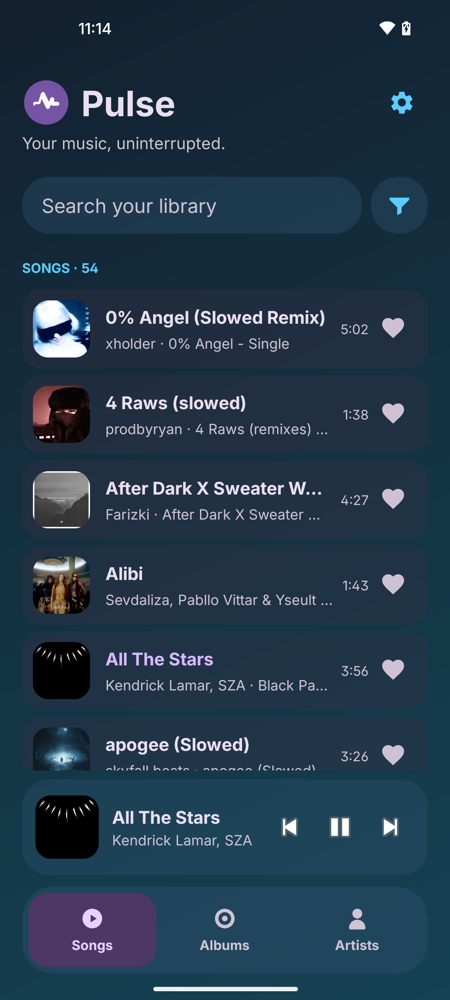
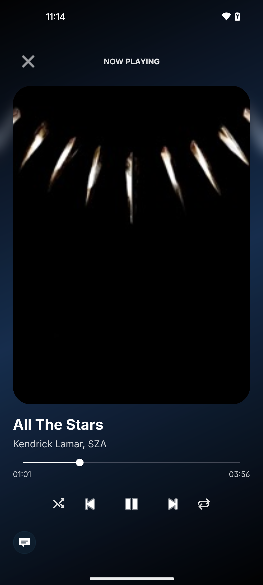
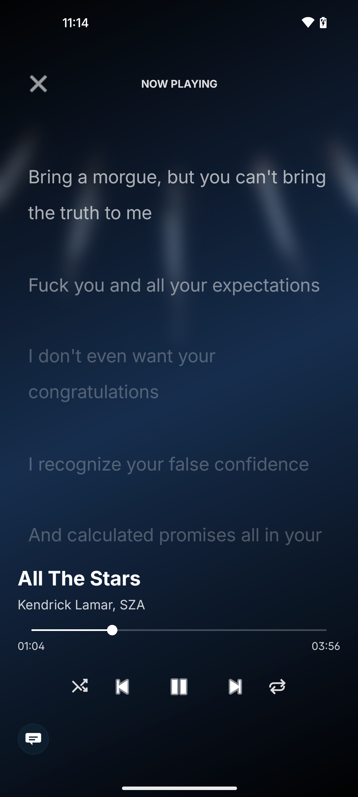

# Pulse

Pulse is a small, private-by-default Android music player. It plays audio already on your device and has no analytics. Discord Rich Presence is optional and uses the installed Discord app when playback is active.

## What it does

- Scans music exposed by Android's media library
- Plays MP3, AAC, FLAC, OGG, WAV, and other formats supported by the device
- Maintains a searchable song library and a play queue
- Continues playback in the background with lock-screen and notification controls
- Can share the currently playing song and artist with Discord Rich Presence when Discord is installed
- Can optionally upload embedded cover art to the user's Cloudflare R2 bucket for Discord Rich Presence
- Shows synchronized lyrics with one crisp active line while surrounding lines fade and blur
- Lets listeners tap a timed lyric line to jump to that point in the song
- Includes glass-style library, full-player, and lyrics views with palette themes and smooth gestures

## Interface

Pulse has three connected listening views:

<p align="center">
  
  
  
</p>

- **Library:** rounded music cards, search, filters, now-playing controls, and Songs/Albums/Artists navigation.
- **Now playing:** large rounded cover art, a blurred cover background, playback controls, sharing, and swipe gestures.
- **Focused lyrics:** the current vocal line stays sharp and bright while the earlier and upcoming lines are softly blurred. Tap a synced line to seek directly to it.

The appearance can be changed in **Settings > Appearance** with built-in glass colors, named color palettes, and community-inspired themes.

## Build an APK

Pulse supports Android 6.0 (API 23) and newer. To build it, install Android Studio and a Java 17 JDK. Android Studio includes the Android SDK manager used by the project.

### Discord Social SDK prerequisite

Discord Rich Presence requires the official Discord Social SDK, which is not committed to this repository because its Android package is too large for normal GitHub repositories. Before building from source, download the base `DiscordSocialSdk` package from the Discord Developer Portal and extract it beside this repository so this path exists:

```text
Pulse/DiscordSocialSdk-1.10.19337/discord_social_sdk/lib/release/discord_partner_sdk.aar
```

The SDK download is available in your Discord application under **Games > Social SDK > Downloads**.

### Build with Android Studio

1. Open this repository folder in Android Studio.
2. When prompted, allow Gradle to sync and install the Android SDK components for API 35.
3. Select the `app` run configuration.
4. Choose **Build > Build APK(s)**.
5. When the build finishes, select **locate** in the notification, or find the debug APK here:

   `app/build/outputs/apk/debug/pulse-v1.2.apk`

You can copy that APK to an Android device and open it to install it. The device may ask you to allow installs from the app used to open the file.

### Build from the command line

From the repository root, run:

```bash
./gradlew assembleDebug
```

On Windows, run:

```bat
gradlew.bat assembleDebug
```

The APK is created at:

```text
app/build/outputs/apk/debug/pulse-v1.2.apk
```

To install it on a connected Android device with USB debugging enabled, run:

```bash
adb install -r app/build/outputs/apk/debug/pulse-v1.2.apk
```

### Create a release APK

For an APK you intend to share, use **Build > Generate Signed Bundle / APK** in Android Studio. Choose **APK**, create or select a keystore, choose the `release` variant, and finish the wizard. Keep the keystore and its passwords private; they are required for future updates to the same app.

The project does not include a signing key, so `assembleRelease` alone creates an unsigned release APK that cannot be installed normally.

## License

MIT. See [LICENSE](LICENSE).
